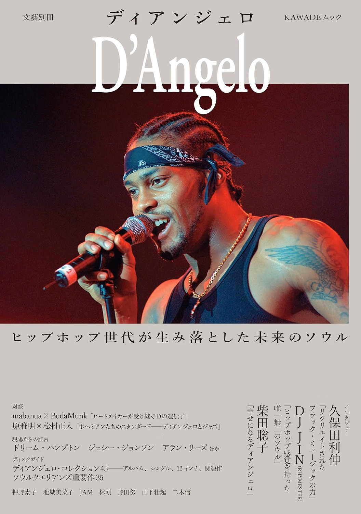

import { Button } from "@carbon/react";
import { ArrowUpRight } from "@carbon/icons-react";

<Row>
  <Column colMd={8} colLg={12} noGutterMdLeft="">
    
Book Review

    <h1 className="h1-no-bottom-margin">ディアンジェロ: ヒップホップ世代が生み落とした未来のソウル (文藝別冊)</h1>
  </Column>
</Row>

<Row>
<Column colMd={3} colLg={4} noGutterMdLeft="">

 

</Column>
<Column colMd={5} colLg={8} noGutterMdLeft="">
  

    
編集

    

      二木信・松村正人
    

     
    
出版社

    

      (株)河出書房新社
    

     
    
ページ数 / サイズ

    

      254ページ / 14.8 x 1.2 x 21 cm 
    

     
    
発売日

    

      2026/4/30
    

     
    
定価

    

      1700円(税抜き)
    

    

    <Button href="https://link.amazon/B0heHtpHc" renderIcon={ArrowUpRight} size='sm' kind='primary'>
      amazon.co.jp
    </Button>
    

  

</Column>
</Row>

<Row>
  <Column colMd={8} colLg={12} noGutterMdLeft="">
    

      2025年10月に亡くなったD'Angeloのアーティスト特集本。冒頭は、池城美菜子によるバイオグラフィー「ヒストリー 1974→2025」で幕を開け、続くインタビューには久保田利伸、DJ JIN（RHYMESTER）、柴田聡子の3名が登場する。久保田利伸のインタビューでは、D'Angelo本人との直接的な関わり自体はわずかに触れられる程度であるものの、90年代中盤から00年代前半にかけて彼が肌で感じていたニューヨークのソウルシーンの空気感や熱量がリアルに語られており、当時の音楽的背景を知るうえで非常に面白い。
       本書の最大の目玉であり、圧巻の読み応えを誇るのが、押野素子の取材・翻訳・構成による「In Their Words: D'Angelo-関係者証言集」だ。ザ・タイムやプリンス周辺での活動でも名高いギタリストのジェシー・ジョンソンや、長年にわたりツアー・マネージャーを務めたアラン・リーズをはじめ、マイケル・ゴンザレス、ドリーム・ハンプトン、ルー・バーバー、ダフニ・A・ブルックスら、D'Angeloの極めて身近にいた重要人物たちの肉声が並ぶ。当時の音楽制作の裏側や時代背景はもちろん、D'Angeloのひととなりや生々しいエピソードが惜しみなく語られており、現場の熱気とリアリティがそのまま伝わってくる。この「関係者証言集」の章を読むためだけでも、十分に購入価値があると感じさせる決定的なパートとなっている。
       中盤には、原雅明×松村正人によるジャズの歴史的変遷からアプローチした対談や、mabanua × BudaMunkという気鋭のクリエイター同士によるビートメイカー対談が収められ、制作者の視点からDのグルーヴの遺伝子が解き明かされる。さらに野田努、池城美菜子、山下壮起による骨太な論考や、JAM（シンガー論）、林剛（プレイヤー論）によるコラムなど、多角的な切り口からD'Angeloの音楽性が深く掘り下げられている。
       お決まりのディスクガイドは2部構成となっている。オリジナルアルバムやシングル、客演・提供楽曲までを網羅した「Part 1 ディアンジェロ・コレクション45」に加え、「Part 2 ソウルクエリアンズ重要作35」が用意されているのが大きな特徴だ。D'Angelo本人のワークスにとどまらず、エレクトリック・レディ・スタジオで共鳴し合ったソウルクエリアンズ周辺のアーティストたちまで幅広くカバーされており、当時のコレクティヴが成し遂げた音響革命の全体像を体系的に捉え直すガイドとして機能している。
    

  </Column>
</Row>
