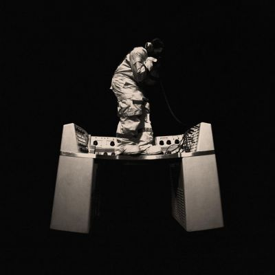

import { Slider, Button } from "@carbon/react";
import { ArrowUpRight } from "@carbon/icons-react";

import SliderJS1 from "../review/slider1";
import SliderJS2 from "../review/slider2";
import SliderJS3 from "../review/slider3";
import SliderJS4 from "../review/slider4";
import AdvJS2 from "../review/adv2";
import AdvJS3 from "../review/adv3";

import { Link } from "gatsby";

Album Review

<h1 className="h1--no--margin">{props.pageContext.frontmatter.title}</h1>

<Row  className="image-card-group">
	<Column colMd={3} colLg={4} noGutterMdLeft="">
       <ImageCard>

</ImageCard>
	</Column>
	<Column colMd={4} colLg={8} noGutterMdLeft="">
		

			ヒューストン出身のRapper, Singer、Don Toliverの約2年ぶりとなる通算5枚目のスタジオアルバム。2018年にTravis
      Scott(当作にもゲスト参加)の作品参加でブレイクし、レーベルCactus Jackと契約したのち、着実なキャリアを重ね、地位を確立しており、本作は全米アルバムチャート（Billboard
      200）で初登場1位を獲得している。コンセプトはモータースポーツやラリーレーシング、そして「更なる加速を促す燃料（OCTANE）」である。
			 ウィルソン山天文台等で制作され、高速走行の疾走感と宇宙的な空間美が融合した世界観を築いている。Don Toliver自身が初めてエグゼクティブプロデューサーを務め、作品全体の美学を力強く指揮している。
      音響面では、サイケデリックなトラップR&amp;Bを基軸に、ヒューストン伝統のチョップド&スクリュー感や重厚な808ベース、宇宙的なシンセを融合させている。
			 さらに「Body」でのJustin Timberlakeや「E85」でのMalcolm Toddのサンプル、生楽器のストリングスなど多角的なアプローチが光る。
      プロデューサー陣には長年の相棒206Derekをはじめ、CardoやBNYX、Da Honorable C.N.O.T.E.、Mike Deanらが集結し多層的な音を構築している。
       Don Toliverのボーカルは、オートチューンを効かせたソウルフルなもので、ファルセットから切れ味あるラップまで自在に行き来し、まるでDJがミキサーを操作するかのように自らの声を旋律的な楽器としてレイヤー状に重ね合わせている。
			 リリックでは、夜のドライブや高級車、ハイピッチな生活の描写とともに、パートナーであるKali Uchisや誕生した子供への愛などパーソナルな側面も描かれている。愛情と依存、警戒心が複雑に交錯する人間模様を、生々しく、時に無防備なほど率直に吐露している。
      Travisの系譜に位置する人だが、次回はさらなる独自性にも期待したい。
		

		

		  <Button className="button-right-mergin"  href="https://link.amazon/B07dPyFmJ" renderIcon={ArrowUpRight} size='sm' kind='primary'>
  	    amazon.com
  	  </Button>
  	  <Button className="button-right-mergin"  href="https://link.amazon/B017qZbGu" renderIcon={ArrowUpRight} size='sm' kind='secondary'>
  	    amazon.co.jp
  	  </Button>
			<Button className="button-right-mergin"  href="https://apple.co/4B1Z9EL" renderIcon={ArrowUpRight} size='sm' kind='tertiary'>
  	    apple music
  	  </Button>
		<AdvJS2/>
		

	</Column>
</Row>
<Row >
	<Column colMd={4} colLg={4} noGutterMdLeft="">
		

		  <h3>Score card</h3>
			<SliderJS1 value="2" />
		  <SliderJS2 value="2" />
			<SliderJS3 value="2" />
		  <SliderJS4 value="8" />
		

	</Column>
	<Column colMd={4} colLg={8} noGutterMdLeft="">
		

			<h3>Producers</h3>
			

				Travis Scott, Aaron Paris, 206Derek and Jaasu(1)
				 Travis Scott, Jaasu, BNYX and Jahaan Sweet(2)
				 Don Toliver, 206Derek, Rio Leyva, Bbykobe and Bangs(3)
				 206Derek, Roark Bailey and Gabe Shaddow(4)
				 Cardo and Polo Boy Shawty(5)
				 Don Toliver, Da Honorable C.N.O.T.E., 206Derek, Oh Ross and Prince85(6)
				 Autrioly, Synthetic, J Hux, Fendii and Frankieontheguitar(7)
				 Wheezy and Sean Momberger(8)
				 206Derek, Jaasu, Tommy Parker, Dylan Wiggins, Chaileah and SkipOnDaBeat(9)
				 Don Toliver, Jahaan Sweet, 206Derek and Roark Bailey(10)
				 206Derek, Rio Leyva, BNYX and Ghost(11)
				 Vendr, 206Derek and Rio Leyva(12)
				 BNYX, Jahaan Sweet, 206Derek, Money Jesus and Jess Jackson(13)
				 FnZ, 30 Roc, 206Derek, Jaasu and Jess Jackson(14)
				 206Derek, Rio Leyva and SkipOnDaBeat(15)
				 FnZ, 206Derek, Rio Leyva, Synthetic and Sharkboy(16)
				 206Derek, Jaasu, Ben10k, Jess Jackson and Thea Gustafsson(17)
				 Don Toliver, 206Derek, Jahaan Sweet, Dylan Wiggins and Mike Dean(18)
			

			<h3>Guests</h3>
			

				Yeat, Rema, Travis Scott, Teezo Touchdown, SahBabii
			

		

	</Column>
</Row>

<h3>Tracks</h3>

| No. | Title                 | Composers                                                                                                                                                                                                         | Performer                         | Time |
| --- | --------------------- | ----------------------------------------------------------------------------------------------------------------------------------------------------------------------------------------------------------------- | --------------------------------- | ---- |
| 1   | E85                   | Caleb Toliver / Jacques Webster II / Aaron Cheung / Derek Anderson / Jaasu Mallory / Malcolm Hobert / Charles Ziman / Jonah Cochran                                                                               | Don Toliver                       | 2:33 |
| 2   | Body                  | Caleb Toliver / Justin Timberlake / Pharrell Williams / Charles Hugo / Jacques Webster II / Jaasu Mallory                                                                                                         | Don Toliver                       | 2:35 |
| 3   | Rendezvous            | Caleb Toliver / Noah Smith / Derek Anderson / Rio Leyva / Kobe Hood / Bennett Pepple                                                                                                                              | Don Toliver feat. Yeat            | 2:26 |
| 4   | Secondhand            | Caleb Toliver / Divine Ikubor / Derek Anderson / Roark Bailey / Gabe Shaddow                                                                                                                                      | Don Toliver feat. Rema            | 3:46 |
| 5   | Tiramisu              | Caleb Toliver / Ronald LaTour Jr. / Damon Hendricks Jr. / Kobe Hood                                                                                                                                               | Don Toliver                       | 2:19 |
| 6   | ATM                   | Caleb Toliver / Carlton Mays Jr. / Derek Anderson / Cole Wainwright                                                                                                                                               | Don Toliver                       | 3:00 |
| 7   | Long Way to Calabasas | Caleb Toliver / Tharusha Mudiyanselage / Theodore Ravhanza / Javier Mercado / Joel Huckle / Joey Fenderson / Francisco Gualter / Edgard Herrera                                                                   | Don Toliver                       | 1:39 |
| 8   | Rosary                | Caleb Toliver / Jacques Webster II / Wesley Glass / Sean Momberger                                                                                                                                                | Don Toliver feat. Travis Scott    | 3:14 |
| 9   | All the Signs         | Caleb Toliver / Harvey Jay Mason / Damon Thomas / Durrell Babbs / Antonio Dixon / Steven L. Russell / Derek Anderson / Jaasu Mallory / Thomas Lumpkins / Dylan Wiggins / Edgar Ferrera                            | Don Toliver feat. Teezo Touchdown | 3:20 |
| 10  | Call Back             | Caleb Toliver / Jahaan Sweet / Derek Anderson / Roark Bailey                                                                                                                                                      | Don Toliver                       | 2:03 |
| 11  | Tuition               | Caleb Toliver / Derek Anderson / Rio Leyva                                                                                                                                                                        | Don Toliver                       | 2:49 |
| 12  | K9                    | Caleb Toliver / Saaheem Valdery / Garrison Webster / Derek Anderson / Rio Leyva                                                                                                                                   | Don Toliver feat. SahBabii        | 2:34 |
| 13  | Excavator             | Caleb Toliver / Benjamin Saint Fort / Jahaan Sweet / Derek Anderson / Desmond Rasberry / Jess Jackson                                                                                                             | Don Toliver                       | 3:31 |
| 14  | Gemstone              | Caleb Toliver / Michael Mulé / Isaac De Boni / Samuel Gloade / Derek Anderson / Jaasu Mallory / Jess Jackson                                                                                                      | Don Toliver                       | 2:01 |
| 15  | Opposite              | Caleb Toliver / Derek Anderson / Rio Leyva / Edgar Herrera                                                                                                                                                        | Don Toliver                       | 2:37 |
| 16  | TMU                   | Caleb Toliver / Michael Mulé / Isaac De Boni / Derek Anderson / Rio Leyva / Javier Mercado / Etham Basden / Siviwe Mngaza / Kaleem Taylor-Decouteau / Alexandra Veltri                                            | Don Toliver                       | 3:00 |
| 17  | Pleasure&#39;s Mine   | Caleb Toliver / Derek Anderson / Jaasu Mallory / Benjamin Wilson / Jess Jackson / Thea Gustafsson                                                                                                                 | Don Toliver                       | 2:57 |
| 18  | Sweet Home            | Caleb Toliver / Robert Ritchie / Matthew Shafer / Ronnie Van Zant / Gary Rossington / Edward King / Robert Wachtel / Warren Zevon / Leroy Marinell / Derek Anderson / Jahaan Sweet / Dylan Wiggins / Michael Dean | Don Toliver                       | 3:20 |

<AdvJS3 />
