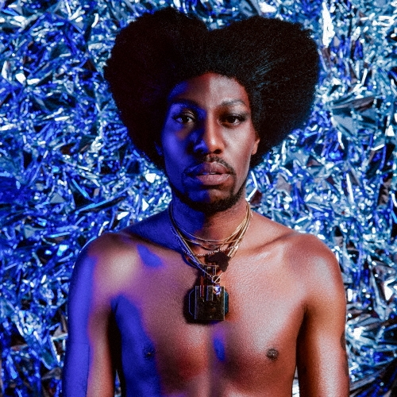

import { Slider, Button } from "@carbon/react";
import { ArrowUpRight } from "@carbon/icons-react";

import SliderJS1 from "../review/slider1";
import SliderJS2 from "../review/slider2";
import SliderJS3 from "../review/slider3";
import SliderJS4 from "../review/slider4";
import AdvJS2 from "../review/adv2";
import AdvJS3 from "../review/adv3";

import { Link } from "gatsby";

Album Review

<h1 className="h1--no--margin">{props.pageContext.frontmatter.title}</h1>

<Row  className="image-card-group">
	<Column colMd={3} colLg={4} noGutterMdLeft="">
       <ImageCard>

</ImageCard>
	</Column>
	<Column colMd={4} colLg={8} noGutterMdLeft="">
		

			ザンビアに生まれボツワナで育ち、現在は南アフリカのヨハネスブルグを拠点に活動するシンガーソングライター/プロデューサー、MOONGA K.の通算3枚目のフルアルバム。
       本作は「2153年の海賊ラジオから送信されたファンクの電波が、1970年代を経由して現代のアフリカで受信される」というアフロフューチャリズム的SFコンセプトに基づいていて、過酷な現実に抗し、「未来が恐怖ではなく“喜び（joy）”を通じて自分たちを記憶していたら？」という問いのもと、ファンクを生存と希望の手段として描いた壮大な作品になっている。
       ただ、サウンド自体は決して大仰なものではなく、1970年代のファンクやソウル、ディスコを軸に、レゲエやザンビア発祥のザムロック（Zamrock）、エレクトロを融合させて、生演奏を活かした躍動感あふれるサウンドが魅力で、軽快なポップ曲が多数。
			本物のストリングスやホーン隊を取り入れ、熱気と厚みを備えた高揚感に満ちたアンサンブルを構築している。
      Frank Oceanに影響を受けて、音楽を始めたということだが、Stevie Wonder, Prince, D'Angelo, Sun Raといったアーティストや70年代ソウルを始めとする多くのブラックミュージックから影響を受けており、一方でアフロビート、アフロポップの色は薄い。
			 制作面では共同プロデューサーのRyan Marshallに加え、スタジオを提供しストリングスやホーン隊の生録音を手掛けたMatthew Gartonが音響面を支えている。
       シルキーなファルセットから生々しい情感を迸らせる力強いソウルフルな歌声まで、豊かな表現力が際立っている。
			繊細で内省的な脆さと、ダンサブルなファンクに乗せる圧倒的なボーカル・ダイナミズムを自在に行き来し、聴き手を惹きつける真摯なメッセージ性と強い説得力を備えている。
       リリックはシリアスな内容で、トラウマや苦難からの回復と自己肯定、集団的な結束、抑圧やジェノサイドへの抗議、社会正義といったメッセージが力強く刻まれている。
		

		

		  <Button className="button-right-mergin"  href="https://link.amazon/B0izi0YXn" renderIcon={ArrowUpRight} size='sm' kind='primary'>
  	    amazon.com
  	  </Button>
  	  <Button className="button-right-mergin"  href="https://amzn.to/XXXXXXX" renderIcon={ArrowUpRight} size='sm' kind='secondary'>
  	    amazon.co.jp
  	  </Button>
		<Button className="button-right-mergin"  href="https://music.apple.com/us/album/6776592227" renderIcon={ArrowUpRight} size='sm' kind='tertiary'>
  	    apple music
  	  </Button>
		<AdvJS2/>
		

	</Column>
</Row>
<Row >
	<Column colMd={4} colLg={4} noGutterMdLeft="">
		

		  <h3>Score card</h3>
			<SliderJS1 value="5" />
		  <SliderJS2 value="3" />
			<SliderJS3 value="1" />
		  <SliderJS4 value="9" />
		

	</Column>
	<Column colMd={4} colLg={8} noGutterMdLeft="">
		

			<h3>Producers</h3>
			

				MOONGA K. and Ryan Marshall(1,2,3,5,11,12,14,15)
				             Ryan Marshall(4,6,7,8,9,10,13)
			

			<h3>Guests</h3>
			

				I Am Roze, Filah Lah Lah
			

		

	</Column>
</Row>

<h3>Tracks</h3>

| No. | Title                     | Composers                                        | Performer                 | Time |
| --- | ------------------------- | ------------------------------------------------ | ------------------------- | ---- |
| 1   | TRANSMISSION 001          | Moonga K Kapambwe, Ryan Marshall                 | MOONGA K.                 | 0:50 |
| 2   | BIG EGO                   | Moonga K Kapambwe, Ryan Marshall                 | MOONGA K.                 | 3:50 |
| 3   | FLY                       | Moonga K Kapambwe, Ryan Marshall                 | MOONGA K.                 | 3:15 |
| 4   | SOMETHING NEW             | Moonga K Kapambwe, Ryan Marshall                 | MOONGA K.                 | 2:10 |
| 5   | STRUT                     | Moonga K Kapambwe, Ryan Marshall, Matthew Garton | MOONGA K.                 | 3:15 |
| 6   | TIME TRAVELLIN&#39; LOVER | Moonga K Kapambwe, Ryan Marshall, Matthew Garton | MOONGA K.                 | 3:30 |
| 7   | SATISFIED                 | Moonga K Kapambwe, Ryan Marshall                 | MOONGA K.                 | 4:20 |
| 8   | TRANSMISSION 002          | Moonga K Kapambwe, Ryan Marshall                 | MOONGA K.                 | 0:25 |
| 9   | HERE IT GOES              | Moonga K Kapambwe, I Am Roze, Ryan Marshall      | MOONGA K. feat. I Am Roze | 3:40 |
| 10  | TO THE SUN                | Moonga K Kapambwe, Filah Lah Lah, Ryan Marshall  | MOONGA K., Filah Lah Lah  | 2:40 |
| 11  | STAR SURFIN&#39;          | Moonga K Kapambwe, Ryan Marshall                 | MOONGA K.                 | 2:35 |
| 12  | TRANSMISSION 003          | Moonga K Kapambwe                                | MOONGA K.                 | 0:45 |
| 13  | LET&#39;S GET LOUD!       | Moonga K Kapambwe                                | MOONGA K.                 | 3:05 |
| 14  | BIRTHRIGHT                | Moonga K Kapambwe                                | MOONGA K.                 | 2:15 |
| 15  | HOPE!                     | Moonga K Kapambwe, Ryan Marshall                 | MOONGA K.                 | 4:35 |

<AdvJS3 />
